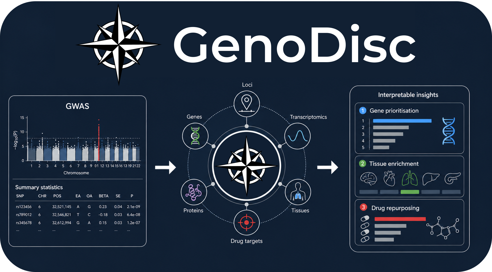

 

<strong>Just want results?</strong> Use the hosted GenoDisc platform → <a href="https://genodisc.er.kcl.ac.uk">genodisc.er.kcl.ac.uk</a>

 

# What is GenoDisc?

GenoDisc is an open-source Snakemake pipeline for post-GWAS functional genomics. Starting from GWAS summary statistics, it runs a standardised battery of analyses — fine-mapping, gene-level and transcriptome/proteome-wide association, heritability, and drug-target enrichment — to help identify the genes, mechanisms, and candidate drugs behind an association signal. It also powers the hosted GenoDisc platform at King’s College London; this site documents how to install, configure, and run the pipeline yourself.

 

# Run GenoDisc yourself

This documentation covers installing, configuring, and running the GenoDisc pipeline on your own machine or HPC.

<a href="pipeline_guide.html" class="button">Learn More</a>

 

# The Hosted Service

Don't want to install anything? Submit your GWAS via the hosted web service — the pipeline runs on our King's College London servers and results appear in an interactive viewer, without any local software installation.

<a href="https://genodisc.er.kcl.ac.uk/" class="button">Go to hosted service ↗</a>

 

Please contact Oliver Pain (oliver.pain@kcl.ac.uk) for any questions or comments.

